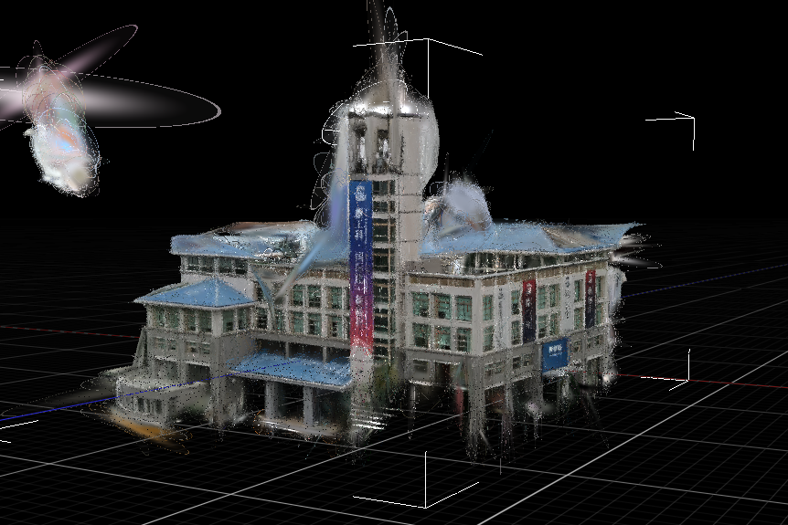
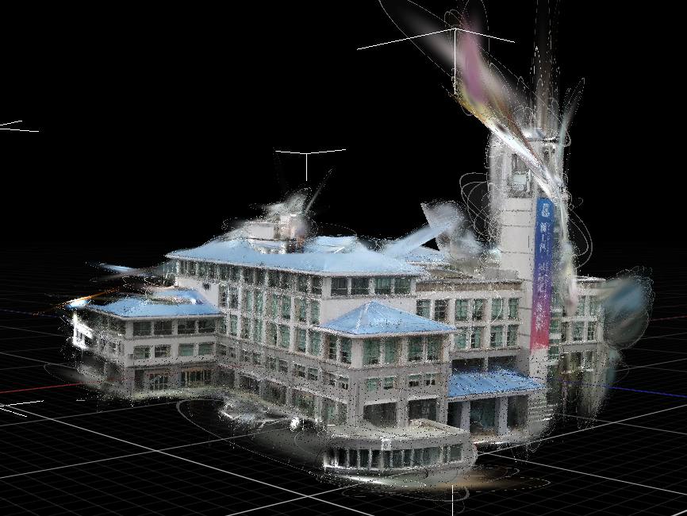

# Raw-To-Three

从手机 / 无人机照片，重建建筑与小物体 3D 高斯模型（3DGS）的一站式流程。

## 流程

```
照片 → COLMAP 位姿解算(SIMPLE_RADIAL) → 图片去畸变(k1→0, PINHOLE)
  → 纯颜色 2DGS 训练 → 去噪(opacity<0.09) → 导出(3DGS / GLB)
```

关键点：2DGS 默认假设相机无畸变，COLMAP 解出的 k1 会被丢弃导致像素错位，
因此训练前必须在数据端做去畸变、把相机改成 PINHOLE——这是小物体 / 近拍场景能重建成功的前提。

## 目录

```
docs/                     说明文档（环境搭建 / 流程 / 拍摄指南 / 平台设计）
scripts/                  核心 pipeline 脚本
  run_colmap.py           COLMAP SfM（含注册率检查）
  pipeline3/undistort_images.py   图片去畸变（保留原文件名）
  pipeline3/patch_cameras.py      SIMPLE_RADIAL → PINHOLE
  denoise.py              去噪（opacity 预过滤 + 统计/半径离群去除）
  convert_to_3dgs.py      2DGS → 3DGS（Supersplat 可查看）
  export_glb.py           导出 GLB（必须 --z_min 1.0，否则泊松 blob 吞目标）
web/                      展示平台：上传照片 → 实时进度 → 3D 结果查看 / 下载
  start.sh / start.bat    一键启动（演示 / Mock 模式）
  frontend/               Next.js 前端（端口 3000）
  backend/                FastAPI 后端（端口 8010）
  backend/mock_data/      演示用占位模型
examples/                 示例结果模型
```

## 快速开始

### 一键启动演示（推荐）

```bash
bash web/start.sh
```

Windows 下直接双击 `web\start.bat`。

脚本会自动安装前后端依赖并启动服务，然后浏览器打开 http://localhost:3000 ：
上传 20 张以上 JPG/PNG 照片 → 实时进度 → 查看结果模型。
演示模式用 `mock_data/` 里的占位模型，**不需要 GPU / COLMAP**，任何装了 Python 3 和 Node.js 的机器都能跑（首次安装依赖需要联网）。

### 手动启动（演示 / Mock 模式）

```bash
# 后端（端口 8010）
cd web/backend && pip install -r requirements.txt && python main.py --mock

# 前端（端口 3000）
cd web/frontend && npm install && npm run dev
# 打开 http://localhost:3000
```

### 跑真实重建（需要 GPU 环境）

展示平台的真实模式会让后端在本机执行重建脚本 `run.sh`，因此需要一台装好 COLMAP / nerfstudio 的机器（环境搭建见 `docs/setup.md`）：

```bash
export RT_PIPELINE_DIR=/path/to/huolong_run   # 该目录下需有 run.sh
cd web/backend && python main.py               # 不带 --mock，即真实模式
```

前端同样 `npm run dev` 打开 http://localhost:3000 。真实重建依赖本机 GPU，无法在普通笔记本上克隆即跑。

### 跑一遍 pipeline（脚本级）

```bash
python scripts/run_colmap.py --image_path <照片目录> --output_path out/colmap
python scripts/pipeline3/undistort_images.py --colmap_dir out/colmap --output_dir out/undistort
python scripts/pipeline3/patch_cameras.py --input out/colmap/sparse/0/cameras.bin --output out/train/cameras.bin --cam_updates out/undistort/cam_updates.json
# 然后 2DGS 训练，输出 point_cloud.ply
python scripts/denoise.py --input point_cloud.ply --output denoised.ply --opacity_min 0.09
python scripts/convert_to_3dgs.py --input denoised.ply --output denoised_3dgs.ply
python scripts/export_glb.py --input denoised.ply --output walls_mesh.glb --z_min 1.0
```

## 示例

图书馆场景 3DGS 模型，约 16.3 万高斯（7 月 30 日结果）：

| 正面 | 侧面 |
|---|---|
|  |  |

模型文件：`examples/denoised_3dgs.ply`（3DGS 格式，可拖入 [superspl.at](https://superspl.at) 查看）。

## 说明

- 深度监督（DA3 深度）暂未接入：深度估计的尺度必须与 COLMAP 对齐，否则模型会炸（16 万 → 600 万高斯、拖 45 米）。尺度对齐解决后再启用。
- 展示平台默认走 **Mock 模式**（用 `web/backend/mock_data/` 的占位模型，便于无 GPU 演示）；真实重建通过环境变量 `RT_PIPELINE_DIR` 指向本机含 `run.sh` 的目录，由 `web/backend/local_runner.py` 本地执行。
